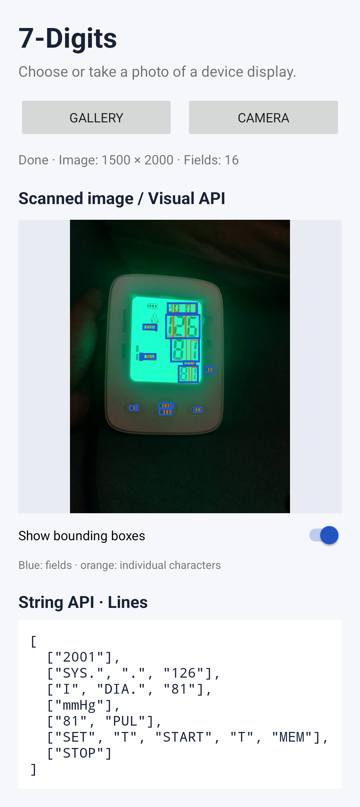

# 7-Segment Digits Scanner

[](https://github.com/artemidius/7-segment-digits-Scanner/actions/workflows/ci.yml)
[](docs/INTEGRATION.md)
[](LICENSE)

An on-device Kotlin/Android library for reading seven-segment displays and printed
Latin text from whole photos. Combines LiteRT and bundled ML Kit OCR behind a small
coroutine API, with a gallery/camera demo. No handwriting recognition is included.

Install `v0.2.0-alpha.1` from [JitPack](https://jitpack.io/#artemidius/7-segment-digits-Scanner).
Add `maven { url = uri("https://jitpack.io") }` to your dependency repositories, then:

```kotlin
implementation("com.github.artemidius:7-segment-digits-Scanner:v0.2.0-alpha.1")
```

See [integration instructions](docs/INTEGRATION.md) for repository filtering and model assets.

```kotlin
val recognizer = SevenDigitsRecognizer.create(context)
val lines = recognizer.recognizeText(bitmap)
// Example shape: [["20", "00"], ["SYS.", "126"], ["DIA.", "81"], ...]
```

**Early preview · model required.** The library ships without trained weights.
The optional research detector has no punctuation classes. General OCR adds labels,
units, punctuation, and additional numbers. Overlapping detector crops and a second
OCR view reduce small-character/backlight misses. Complete-screen recognition is
the goal, not an accuracy guarantee across thermometers, meters, and sensors. See [model capabilities and licensing](docs/MODELS.md).

## Two APIs, one pipeline

- **Text:** `Lines` is exactly `List<List<String>>` — rows top to bottom, fields left to right.
- **Visual:** text, field/character boxes, and confidence scores, with `toLines()` for
  text from the same inference.
- **Coroutines:** work runs off the caller's thread; cancellation and native cleanup
  are handled internally. No public `close()`.
- **Whole-image input:** resizing, rotation, small-character passes, duplicate removal,
  detection, and grouping are internal.
  Returned boxes use the input bitmap's coordinates.

```kotlin
val visual = recognizer.recognizeVisual(bitmap)
val boxes = visual.regions.map { it.boundingBox }
val lines = visual.toLines()
```

The library returns raw detected content. Your app decides what a value means;
there is no date/time or medical interpretation, filtering, or guessed missing digits.

## Get started

1. Add the JitPack dependency, or download an AAR/Maven bundle from
   [Releases](https://github.com/artemidius/7-segment-digits-Scanner/releases).
2. Add a compatible, appropriately licensed model and JSON metadata to app assets.
3. Create a recognizer in a coroutine and call either API.

The [integration guide](docs/INTEGRATION.md) covers dependencies, assets, coroutine
usage, overlays, rotation, and errors. Downloadable Maven bundles include dependency
metadata. JitPack resolves runtime dependencies automatically; Maven Central is not configured.

## Build and try the demo

JDK 21, Android SDK 37.0, build-tools 36.0.0, and Python 3 are recommended.

```sh
./gradlew :library:assembleRelease
python3 scripts/prepare_test_app.py --aar-only
./gradlew :test-app:assembleDebug
```

This builds the library and a model-free demo from a fresh checkout. For working
recognition, follow [model setup](docs/MODELS.md), then run:

```sh
python3 scripts/prepare_test_app.py
./gradlew :test-app:installDebug
```

The demo imports the actual AAR file. Gallery and Camera return to one screen with
the photo, optional bounding boxes, raw `Lines`, and the detailed visual result.
Camera uses the system camera app with temporary access to one photo; the demo
requests no camera or storage permission.



Screenshot of the original digits-only release. The development version also returns
clock digits and printed labels on these fixtures; this is not an accuracy benchmark.
[Image attribution](THIRD_PARTY_NOTICES.md#example-photos-and-screenshot).

## Quality and development

CI builds the library and AAR consumer, runs JVM/Python tests and Android lint,
verifies release contents, and exercises real-model inference on Android 23 and 34.
Tagged releases repeat those checks before publishing model-free artifacts and checksums.

| Guide | Contents |
| --- | --- |
| [Integration](docs/INTEGRATION.md) | Add the library and use both APIs |
| [API contract](docs/API.md) | Types, coordinates, cancellation, and errors |
| [Models](docs/MODELS.md) | Tensor contract, provenance, optional conversion |
| [Development](docs/DEVELOPMENT.md) | Fresh builds, demo, tests, CI, releases |
| [Contributing](CONTRIBUTING.md) | Changes, evidence, and review expectations |
| [Changelog](CHANGELOG.md) | Release history |

## License

Our code is [Apache-2.0](LICENSE). ML Kit is a separately licensed Google SDK and
model dependency; image recognition runs on-device, while its SDK may send usage
metrics under [Google’s terms](https://developers.google.com/ml-kit/terms).
Optional SMART-BP weights retain their upstream
AGPL-3.0 terms and are not bundled in library releases. See
[third-party notices](THIRD_PARTY_NOTICES.md). This project is independent of the
model authors and does not claim their endorsement.
